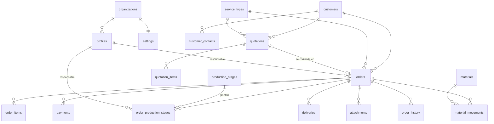

# Arquitectura — Sistema de gestión para orfebrería (MVP)

## 1. Análisis de arquitectura

```
Angular 21 (SPA, standalone, signals, zoneless)
   │  supabase-js (clave publishable/anon + JWT del usuario)
   ▼
Supabase
   ├─ Auth (email + password)            → profiles (rol, organización, activo)
   ├─ PostgREST (tablas + RPC)            → RLS en TODAS las tablas
   ├─ PostgreSQL: triggers y funciones    → reglas de negocio, totales, stock, auditoría, numeración
   └─ Storage (bucket privado "orders")   → políticas por pedido
```

* **No hay backend propio.** Las reglas que deben cumplirse siempre (totales, saldo, stock, transiciones de estado,
  auditoría, pedido cerrado inmodificable, numeración) viven en PostgreSQL como triggers y funciones. Así se aplican
  igual desde la app, el SQL Editor o integraciones futuras. Angular solo valida para dar una buena experiencia.
* **Multiempresa desde el día 1:** todas las tablas de negocio llevan `org_id` (por defecto `current_org_id()`) y todas
  las políticas RLS filtran por organización. El MVP opera con una organización. Para pasar a SaaS basta con
  agregar el alta de organizaciones e invitaciones; no hay que migrar datos.
* **Edge Functions:** no se necesitan en el MVP. Se reservan para invitar usuarios (requiere `service_role`),
  WhatsApp y facturación electrónica (SUNAT).

## 2. Estructura de carpetas

```
supabase/
  migrations/0001..0008_*.sql   # fuente de verdad del esquema
  schema.sql                    # generado: npm run db:schema
  seed.sql                      # datos demo
src/app/
  core/        auth/ guards/ services/ models/ (supabase client, auth, lookups, notificaciones)
  layout/      main-layout/ sidebar/ topbar/
  shared/      components/ (page-header, status-tag, field-error, empty-state, money...) pipes/ utils/
  features/
    auth/            login, registro, cuenta pendiente
    dashboard/
    customers/       pages/ components/ services/ models/
    quotations/      pages/ components/ services/ models/
    orders/          pages/ components/ services/ models/   ← módulo principal
    production/      kanban
    materials/       catálogo + movimientos
    payments/
    deliveries/
    settings/        empresa, usuarios, etapas, tipos de servicio
```

## 3. Modelo entidad-relación



## 4. Esquema SQL

Ver `supabase/migrations/` (comentado). Puntos clave:

| Tabla | Notas |
|---|---|
| `profiles` | 1:1 con `auth.users`. El primer usuario queda como ADMIN activo; los demás quedan **inactivos** hasta que un ADMIN los active. El rol nunca se toma de la metadata del cliente. |
| `quotations` / `quotation_items` | Totales (subtotal, descuento, IGV, total) calculados por trigger. Transiciones de estado validadas. Solo se editan en Borrador/Enviada. |
| `orders` | `amount_paid` lo mantiene el trigger de pagos; `balance` y `payment_status` son columnas generadas. `progress`, `current_stage_name` y `qc_approved` se sincronizan desde las etapas. |
| `order_production_stages` | Índice único parcial: **una sola etapa actual por pedido**. |
| `material_movements` | Inmutables. `EMPRESA` afecta el stock (con bloqueo `FOR UPDATE` y validación de stock suficiente). `CLIENTE` no afecta el stock y lleva el saldo por pedido (vista `order_client_materials`). |
| `payments` | No se borran ni se editan: se **anulan** con motivo. Un pago mayor al saldo requiere `overpayment_confirmed`. |
| `deliveries` | Al marcarse ENTREGADA exige control de calidad aprobado y conformidad, registra la fecha real y pasa el pedido a Entregado. |
| `order_history` | Solo la escriben los triggers (`SECURITY DEFINER`). Ningún usuario puede insertar ni modificar. |
| `document_sequences` | Correlativos `COT/PED/ENT-AAAA-000001` con `INSERT … ON CONFLICT DO UPDATE … RETURNING` (bloqueo de fila, sin duplicados en concurrencia). |

Flujo de estados del pedido (automático según producción, manual en el resto):

```
SOLICITUD → COTIZADO → APROBADO → DISEÑO → PRODUCCIÓN → CONTROL_CALIDAD → LISTO_ENTREGA → ENTREGADO → CERRADO
                        (PAUSADO / CANCELADO en cualquier punto)
```
* Inicia una etapa → Diseño/Producción · Terminan las etapas de trabajo → Control de calidad (regla 10)
* Se completa la etapa de control de calidad → Listo para entregar (`qc_approved`)
* Entrega registrada → Entregado · Cerrar exige: producción completa + QC aprobado + entrega registrada

## 5. Políticas RLS

| Recurso | ADMIN | GERENTE | VENDEDOR | SUPERVISOR | ORFEBRE |
|---|---|---|---|---|---|
| Clientes | CRUD | CRU | CRU | R | R (solo clientes de sus pedidos) |
| Cotizaciones | CRUD | CRU | CRU | – | – |
| Pedidos | todo | CRU | CRU | RU | R (asignados) |
| Etapas de producción | todo | todo | crear | todo | actualizar las suyas |
| Materiales (catálogo) | CRU | CRU | R | R | R |
| Movimientos | C/R | C/R | C/R en pedidos | C/R | C/R en sus pedidos |
| Pagos | C/R/anular | C/R/anular | C/R | – | – |
| Entregas | CRU | CRU | CRU | CRU | – |
| Adjuntos (+Storage) | todo | todo | sus pedidos visibles | ídem | sus pedidos |
| Usuarios / configuración | CRU | R | R | R | R |

`anon` no tiene ninguna política. Usuario inactivo → `current_org_id()` es NULL → no ve nada.
Además, los pedidos cerrados o cancelados solo los modifica un ADMIN (lo controla un trigger, no una política).

## 6. Rutas Angular

| Ruta | Página | Roles (guard de UX; la seguridad real es RLS) |
|---|---|---|
| `/login`, `/registro`, `/cuenta-pendiente` | Autenticación | público |
| `/dashboard` | Dashboard gerencial | ADMIN, GERENTE |
| `/customers`, `/customers/new`, `/customers/:id`, `/customers/:id/edit` | Clientes y ficha 360° | ADMIN, GERENTE, VENDEDOR, SUPERVISOR |
| `/quotations`, `/quotations/new`, `/quotations/:id`, `/quotations/:id/edit` | Cotizaciones | ADMIN, GERENTE, VENDEDOR |
| `/orders`, `/orders/new`, `/orders/:id`, `/orders/:id/edit` | Pedidos | todos (el orfebre ve solo los suyos) |
| `/production` | Kanban de producción | ADMIN, GERENTE, SUPERVISOR, ORFEBRE |
| `/materials`, `/materials/:id` | Materiales y kardex | ADMIN, GERENTE, SUPERVISOR |
| `/payments` | Pagos | ADMIN, GERENTE, VENDEDOR |
| `/deliveries` | Entregas | ADMIN, GERENTE, VENDEDOR, SUPERVISOR |
| `/settings` | Empresa, usuarios, etapas, servicios | ADMIN |

Todas las features se cargan con `loadChildren` / `loadComponent` (lazy loading).

## 7. Decisiones importantes

1. **Reglas de negocio en la base de datos.** Si un dato solo es correcto cuando la UI se comporta bien, no es
   correcto. Totales, saldo, stock y auditoría se calculan en PostgreSQL. Angular muestra y valida, nada más.
2. **RPC transaccionales** para operaciones de varias tablas (`save_quotation`, `save_order`,
   `convert_quotation_to_order`, `create_order_stages`, `duplicate_quotation`, `get_dashboard`). Son
   `SECURITY INVOKER`, así que respetan el RLS del usuario.
3. **Sin borrado físico** de información crítica: clientes y materiales con `active`, pagos anulados, adjuntos
   con `deleted_at`, movimientos inmutables.
4. **Estados como `text` + `CHECK`** en lugar de `ENUM`: agregar un estado es un `ALTER … CHECK`, sin bloqueos.
5. **Signals + servicios por feature**, sin NgRx: el estado es mayoritariamente de servidor y por página.
6. **PDF de cotizaciones con jsPDF**, generado en el cliente (sin servidor).
7. **Kanban con Angular CDK DragDrop** (dependencia obligatoria de PrimeNG 21, soporta pantallas táctiles), más
   un menú de cambio de estado en cada tarjeta como alternativa accesible.
